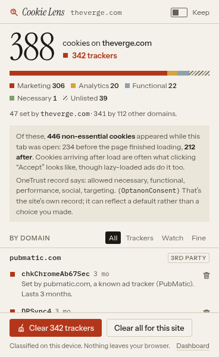
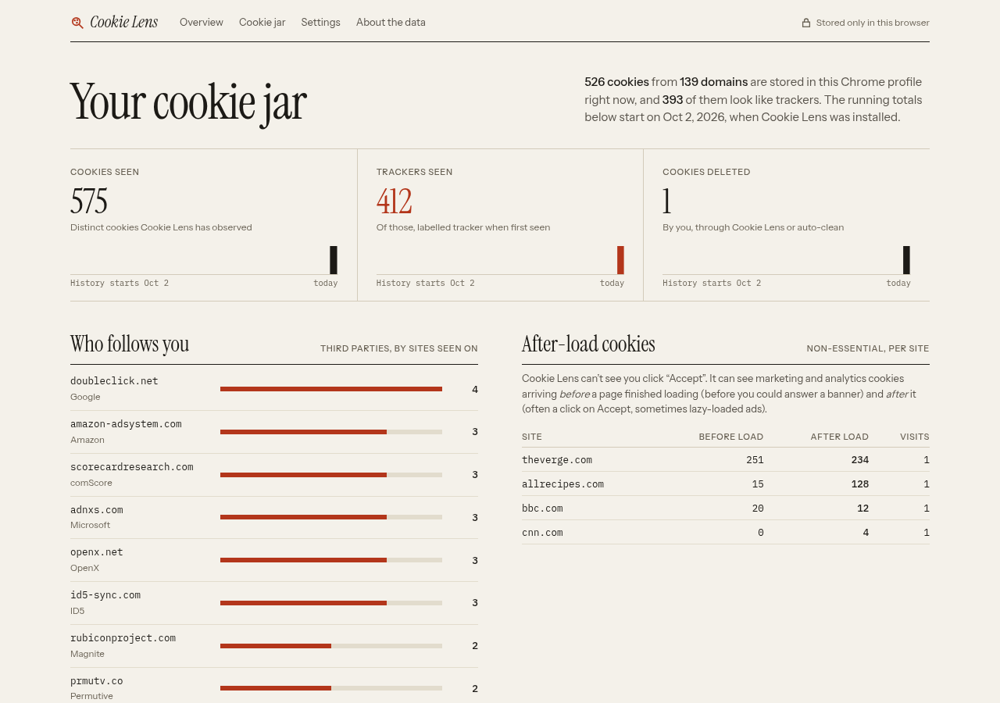
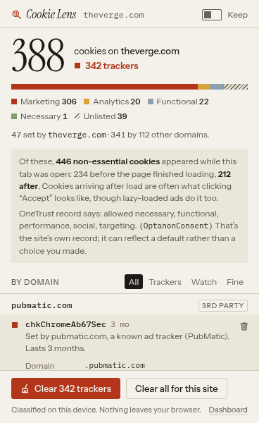
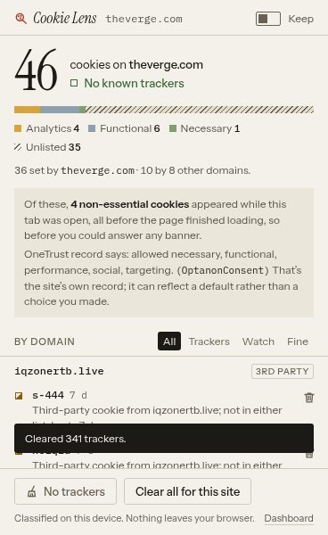
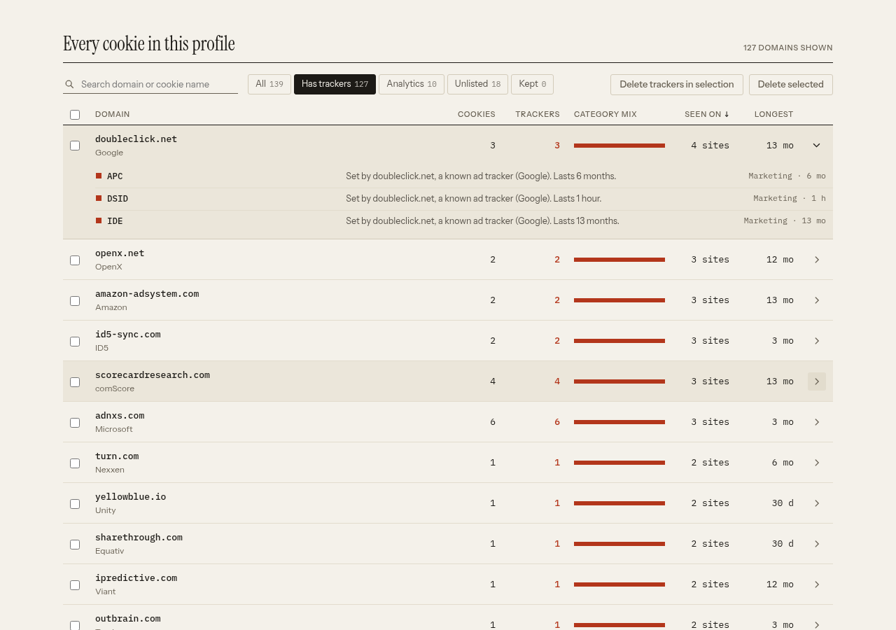
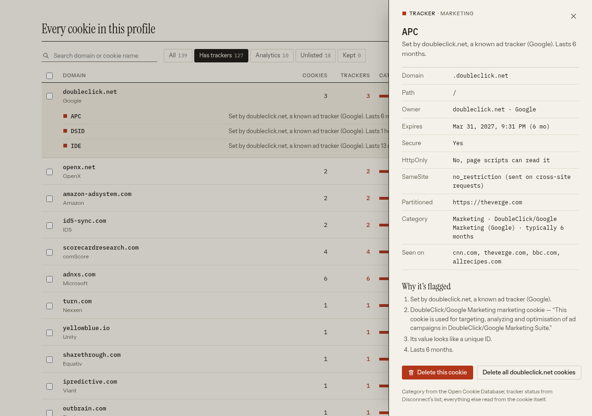

# Cookie Lens

A Chrome extension that shows which cookies a site sets, which ones track you and why, and lets you clear them.
Classification happens on your device. Nothing leaves your browser.

 

## What it does

**Toolbar popup (current tab)**
- How many cookies the page has, split between the site itself and the third parties it loaded.
- A category breakdown (Marketing / Analytics / Functional / Necessary / Unlisted) and a risk level for each cookie,
  with a plain-English reason, e.g. *"Set by pubmatic.com, a known ad tracker (PubMatic). Lasts 3 months."*
- Delete one cookie, **Clear trackers** for the site, or **Clear all for this site**.
- A **Keep** switch that adds the site to your keep list.
- The badge on the toolbar icon shows the number of trackers in the active tab.

**Dashboard (full page, also the options page)**
- Running totals stored in `chrome.storage.local`: cookies seen, trackers seen and cookies deleted, with 30-day charts.
- *Who follows you*: third-party domains ranked by how many of your sites they set cookies on.
- *After-load cookies*: per site, how many non-essential cookies showed up before vs after the page finished loading (see "Accepted cookies" below).
- Every cookie in the profile, grouped by domain: search, filter chips, sortable columns, checkboxes for bulk delete,
  and a details drawer showing domain, path, expiry, Secure, HttpOnly, SameSite, partition, category, the sites it was seen on, and the reasons it was flagged.
- Keep list, optional **auto-clean trackers when a tab closes** (off by default), JSON export, and a history reset.

| | |
|---|---|
|  |  |
|  |  |

More in [`screenshots/`](screenshots/): the full dashboard page, the keyboard focus state, the dashboard after clean-up, and the empty state on `chrome://` pages.

## Install (Load unpacked)

1. Download or clone this repo (or unzip `cookie-lens.zip`).
2. Open `chrome://extensions` and turn on **Developer mode** (top right).
3. Click **Load unpacked** and choose the `extension/` folder (or the unzipped folder).
4. Pin Cookie Lens from the puzzle-piece menu. Open any website and click the icon.
5. Tabs that were already open before you installed it only show first-party cookies until you reload them.

## How cookies are classified

Three bundled datasets, no network lookups:

1. **Open Cookie Database**: cookie name to category, platform and description (exact and prefix matches, e.g. `_ga_*`).
2. **Disconnect tracking protection list**: cookie domain to tracker type (advertising, social, analytics, fingerprinting, cryptomining) and owning company.
3. **Public Suffix List**: decides what counts as the same site, so `ads.bbc.co.uk` vs `bbc.co.uk` is judged correctly.

Heuristics on top, each shown as a sentence and never folded into a hidden score: is it third-party, how long does it last (with a note when it's longer than ~13 months), does its value look like a unique ID (≥16 chars with high Shannon entropy, checked in memory only), and is it missing the Secure flag.

| Level | Rule |
|---|---|
| **Tracker** (filled square) | Third-party cookie from a listed ad/social/fingerprinting/cryptomining domain; any cookie the Open Cookie Database calls Marketing; or a third-party, ID-like cookie that lasts more than 30 days. |
| **Watch** (half square) | Analytics (listed or by name); a third-party cookie with an ID-like value; or a persistent third-party cookie we can't identify. |
| **Fine** (outline square) | Necessary/functional cookies, or first-party cookies with no tracking signal. |

Tracker-list matches only count for **third-party** cookies, the same approach Firefox's Enhanced Tracking Protection takes, so visiting google.com doesn't flag Google's own login cookies just because Google is on the list.

### "Accepted cookies", honestly
An extension can't see whether you clicked Accept on a consent banner. Cookie Lens reports what it can actually measure:
- **Before load / after load**: non-essential (marketing, analytics or tracker) cookies created before the page's `load` finished, so before you could have answered a banner, versus more than 1 s after it. A burst after load often means someone clicked Accept, but lazy-loaded ads can do the same. The UI says exactly that.
- **The site's own consent record**, when the format is known: OneTrust `OptanonConsent` groups, Cookiebot `CookieConsent`, and the presence of an IAB TCF `euconsent-v2` string. It's quoted, with a note that it may reflect a default rather than your choice.

## Permissions

| Permission | Why |
|---|---|
| `cookies` | Read, classify and delete cookies. |
| `host_permissions: <all_urls>` | Chrome only lets an extension read or delete cookies for hosts it has access to. Third-party trackers can be on any domain. It also lets the extension read the active tab's URL, so the broader `tabs` permission isn't needed. |
| `webRequest` | **Observe-only** (nothing is blocked or modified): records which hosts each tab contacts, so the popup can find that page's third-party cookies. Only hostnames are kept, in session storage, and they're dropped when the tab closes. |
| `webNavigation` | Knows when a page started and finished loading, for the before/after-load counts. |
| `storage` | Settings, keep list and running totals in `chrome.storage.local`. Per-tab state goes in `chrome.storage.session`. |

The extension has no content scripts, no remote code, makes no network requests (its CSP sets `connect-src 'self'`), and has no analytics. It stores cookie names, domains and counts, **never cookie values**.

## Limitations

- **"Tracker" is a judgement backed by a list or a strong signal, not proof of harm.** Unlisted cookies are labelled *Unlisted* rather than guessed at.
- Tracking without cookies (fingerprinting, localStorage, server-side or login-based tracking) isn't measured.
- Third-party detection depends on seeing a tab's requests, so tabs open before install or before a browser restart show first-party cookies only until they're reloaded. Paths are approximate: cookies are read per host at `/`.
- Before/after-load timing is a proxy for consent, not consent itself.
- Deleted cookies often come back when you reload, because the site sets them again. Auto-clean waits 1.5 s after a tab closes, then skips trackers another open tab is still using.
- Totals start at install. "Cookies seen" is capped at the most recent 40,000 distinct cookies.
- The Disconnect list is CC BY-NC-SA: fine for this free, open project, but a commercial fork would need a different list or a license from Disconnect.
- The partitioned (CHIPS) cookie APIs vary across Chrome versions. Tested on Chromium 153.

## Development

```
npm install
npx playwright install chromium
npm run build:data     # data-src/* -> extension/data/*.json
npm run build:icons    # design/icon.svg -> extension/icons/*.png
npm test               # loads the extension in headless Chromium and runs it against real sites
npm run zip            # -> cookie-lens.zip
```

`tests/e2e.mjs` launches Chromium with `--load-extension`, visits cnn.com, theverge.com, bbc.com/news and allrecipes.com,
and checks detection, classification, the badge, per-cookie delete, Clear trackers, stored stats, auto-clean on tab close,
the keyboard path and the drawer, then saves the screenshots. The latest results are in `tests/last-run.json`. Branded Google Chrome 137+ ignores `--load-extension`, so the test uses Playwright's Chromium.

Design notes: [`DESIGN_BRIEF.md`](DESIGN_BRIEF.md) ("Field Guide" direction). Research: [`RESEARCH.md`](RESEARCH.md).

### Layout
```
extension/            the unpacked extension (load this)
  manifest.json
  background.js       service worker: request/host tracking, cookie timing, badge, deletion, stats
  popup.html/js       toolbar popup
  dashboard.html/js   full-page dashboard and options
  lib/                data loading + PSL, classifier, icons
  data/               bundled datasets (see THIRD_PARTY_NOTICES.md)
  styles/ fonts/ icons/
data-src/             upstream datasets as downloaded
scripts/              data + icon build scripts
tests/                Playwright end-to-end test
```

## License
Code: MIT © 2026 Sheina Pribadi. Data and fonts: see [`extension/THIRD_PARTY_NOTICES.md`](extension/THIRD_PARTY_NOTICES.md).
